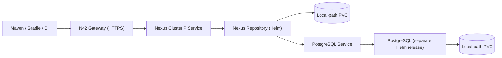

# Nexus Artifact Repository on Kubernetes

Single-instance Nexus Community Edition architecture for internal Maven and Gradle artifacts, deployed on KIND.

## Architecture



## Platform prerequisites

- A running KIND cluster, `kubectl`, and Helm.
- A default local-path StorageClass and dynamic PVC provisioning.
- N42 Gateway controller and a Gateway configured for HTTPS termination.
- Local certificate trust for the chosen development hostname.
- A PostgreSQL Helm release with its own PVC. Database credentials must be provided through a Kubernetes Secret, not committed files.
- Adequate node memory and disk capacity for Nexus and PostgreSQL.

**KIND setup references**

- [KIND cluster setup](https://blog.npanda.online/mykindk8scluster/)
- [N42 Gateway on KIND](https://blog.npanda.online/n42-gateway-kind/)
- [KIND official documentation](https://kind.sigs.k8s.io/docs/user/quick-start/)
- [Gateway API documentation](https://gateway-api.sigs.k8s.io/)
- [Sonatype official Helm chart](https://github.com/sonatype/nxrm3-ha-repository)

**Storage:** Local-path PVCs are appropriate for a single-node test environment. Cluster deletion may remove the data. S3 is not a prerequisite for this deployment.

## Chart inspection

```bash
./run.sh
```

The script checks local tooling, KIND context, storage and Gateway resources. It downloads and inspects a pinned upstream `nxrm-ha` chart without installing anything.

## Architecture decisions

| Area | Design |
|---|---|
| Application | Nexus Community Edition, one instance |
| Deployment | Pinned official `nxrm-ha` chart with minimal CE-specific adaptations |
| Database | Separate PostgreSQL Helm release |
| Network | ClusterIP and N42 Gateway API with HTTPS |
| Storage | Local-path PVCs for Nexus and PostgreSQL |
| Access | Nexus authentication and role-based permissions |

## Compatibility boundary

The official chart is primarily designed for licensed Nexus Pro installations. Before installation, review the rendered image, database settings, license flags, storage and Pro-specific resources. Any CE adaptation must be explicit and tested. Chart inspection alone does not establish CE compatibility.

**Status:** Chart and environment verification. No Nexus resources deployed.
