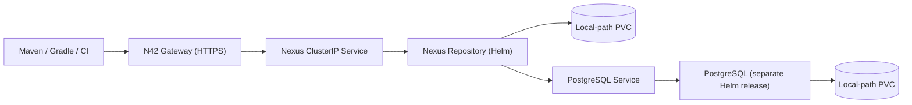

# Nexus Artifact Repository on Kubernetes

Single-instance Nexus Community Edition architecture for internal Maven and Gradle artifacts, deployed on KIND.

## Architecture



## Platform prerequisites

- A running KIND cluster, `kubectl`, and Helm.
- A default local-path StorageClass and dynamic PVC provisioning.
- N42 Gateway controller and a Gateway configured for HTTPS termination.
- Local certificate trust for the chosen development hostname.
- A PostgreSQL Helm release with its own PVC. Database credentials must be provided through a Kubernetes Secret, not committed files.
- Adequate node memory and disk capacity for Nexus and PostgreSQL.

**KIND setup references**

- [KIND cluster setup](https://blog.npanda.online/mykindk8scluster/)
- [N42 Gateway on KIND](https://blog.npanda.online/n42-gateway-kind/)
- [KIND official documentation](https://kind.sigs.k8s.io/docs/user/quick-start/)
- [Gateway API documentation](https://gateway-api.sigs.k8s.io/)
- [Sonatype official Helm chart](https://github.com/sonatype/nxrm3-ha-repository)

**Storage:** Local-path PVCs are appropriate for a single-node test environment. Cluster deletion may remove the data. S3 is not a prerequisite for this deployment.

## Cost and licensing

| Item | Cost or constraint |
|---|---|
| Nexus Community Edition | No license fee; Sonatype Community Edition EULA applies |
| Community Edition usage | Up to 40,000 components and 100,000 requests per day |
| PostgreSQL, Helm and KIND | No software license fee for this configuration |
| Existing self-hosted VM | No additional VM purchase assumed; CPU, memory, disk, power and maintenance still have a cost |
| Local-path PVC and self-signed TLS | No third-party service charge; storage capacity and certificate trust must be managed |
| Nexus Pro | Commercial subscription; pricing depends on edition and usage |

Exceeding Community Edition limits blocks new component additions until usage returns within the limits or the deployment is upgraded. Monitor the Nexus Usage Center.

## Solution fit

| Scenario | Fit | Architecture consideration |
|---|---|---|
| Personal development and KIND evaluation | **Good** | Free CE edition, single replica and local persistent storage |
| Small internal build team | **Conditional** | Suitable below CE limits; requires backup, access controls and capacity planning |
| Business-critical artifact service | **Not recommended for this design** | Single VM, single Nexus instance and local PVCs are failure points |
| High availability or multi-node deployment | **Pro required** | CE does not include HA or clustering |
| Artifact storage on AWS S3 or other cloud object storage | **Pro required** | CE does not include cloud blob stores |
| Enterprise SSO and disaster recovery replication | **Pro required** | Commercial edition features |

## Key design trade-offs

- The official `nxrm-ha` chart is primarily intended for licensed Pro deployments. CE compatibility must be verified against the pinned chart and any local patch.
- PostgreSQL is deployed separately for independent lifecycle management; it does not make the deployment highly available.
- Local-path storage keeps the lab self-contained but does not replace backup or disaster recovery.
- S3 is not needed for this architecture. It is not available as a Nexus CE cloud blob store.

## Product references

- [Sonatype editions and feature availability](https://help.sonatype.com/en/nexus-repository-tiers-and-feature-availability.html)
- [Community Edition usage limits](https://help.sonatype.com/en/usage-center.html)
- [Community Edition download and EULA](https://www.sonatype.com/products/nexus-community-edition-download)
- [Sonatype pricing](https://www.sonatype.com/products/pricing)
- [Official Nexus HA chart](https://github.com/sonatype/nxrm3-ha-repository)

## Platform validation and chart inspection

From the repository root, check the existing KIND platform:

```bash
./setup.sh
```

Then inspect the Nexus chart in this project directory:

```bash
cd platform-engineering/core-02-nexus-artifact-repository
./run.sh
```

`setup.sh` performs shared Kubernetes checks. `run.sh` downloads and inspects the pinned Nexus chart without installing it.

## Architecture decisions

| Area | Design |
|---|---|
| Application | Nexus Community Edition, one instance |
| Deployment | Pinned official `nxrm-ha` chart with minimal CE-specific adaptations |
| Database | Separate PostgreSQL Helm release |
| Network | ClusterIP and N42 Gateway API with HTTPS |
| Storage | Local-path PVCs for Nexus and PostgreSQL |
| Access | Nexus authentication and role-based permissions |

## Compatibility boundary

The official chart is primarily designed for licensed Nexus Pro installations. Before installation, review the rendered image, database settings, license flags, storage and Pro-specific resources. Any CE adaptation must be explicit and tested. Chart inspection alone does not establish CE compatibility.

**Status:** Chart and environment verification. No Nexus resources deployed.
